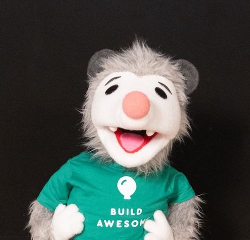
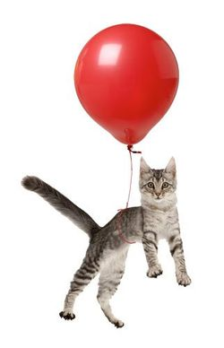
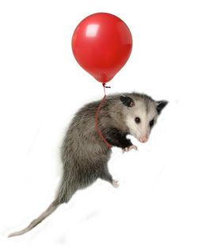
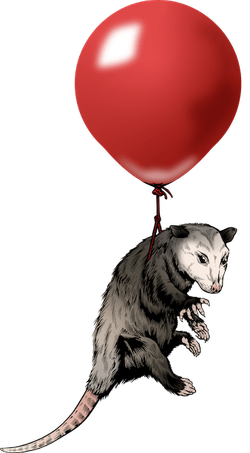
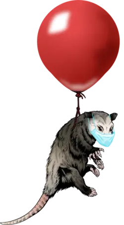
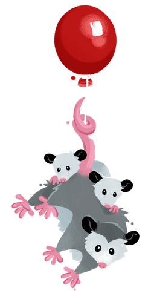
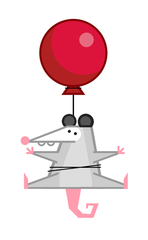
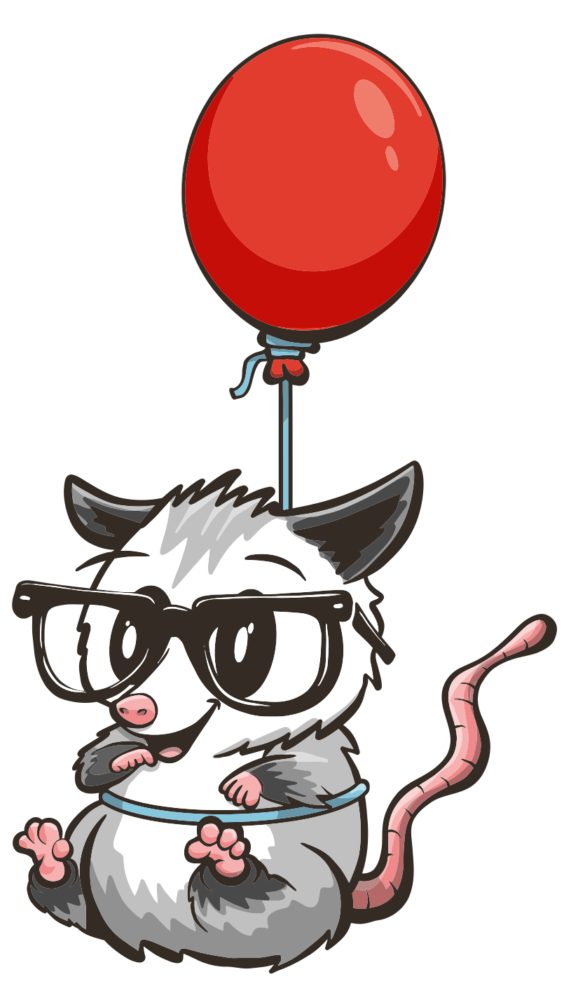

As Eleventy [enters the Awesomeverse as Build Awesome](https://www.11ty.dev/blog/build-awesome/) and joins the esteemed ranks of both Font Awesome and Web Awesome, the possum is taking on more responsibility as well.

That’s right, the new iteration of our beloved possum mascot will be representing the larger Awesomeverse of open source projects as well (complete with custom wardrobe)!

[Puppeteer](https://pptr.dev/) isn’t just for headless browsers any more.

You can read the history of our prior possum commissions:

-   [_November 2023_ from David Neal](https://www.11ty.dev/blog/mascot-david/)
-   [_October 2021_ from Geri Coady](https://www.11ty.dev/blog/new-mascot-from-geri-coady/)
-   [_December 2019_ from Phineas X. Jones](https://www.11ty.dev/blog/logo-homage/)
-   [_May 2018_ from James Williamson](https://web.archive.org/web/20200307013845/https://twitter.com/jameswillweb/status/999052022497316865)

## Eleventy Mascot Series

[

**(Unknown Name)**](https://web.archive.org/web/20200307013845/https://twitter.com/jameswillweb/status/999052022497316865)

_James Williamson._ 22 May 2018. Before the possum, there was the cat

[

**Edison**](https://web.archive.org/web/20200307013845/https://twitter.com/jameswillweb/status/999052022497316865)

_James Williamson._ 22 May 2018. James pioneered the static-generating possum.

[

**Grumpy**](https://www.11ty.dev/blog/logo-homage/)

_Phineas X. Jones._ 18 December 2019. Our first commissioned iteration.

[

**Masked Grumpy**](https://www.11ty.dev/blog/logo-homage/)

_Remixed by Ben Brignell._ 7 July 2020

[

**(Not yet named)**](https://www.11ty.dev/blog/new-mascot-from-geri-coady/)

_Geri Coady._ July 2021. Our second commission! The community has grown.

[

**A Single Div**](https://a.singlediv.com/#rise)

_Lynn Fisher._ October 2022. From a.singlediv.com.

[

**Elle**](https://www.11ty.dev/blog/mascot-david/)

_David Neal._ November 2023. Our third commission! We’re getting smarter.

[

**Awesome Possum**](https://www.11ty.dev/blog/awesome-possum/)

_Font Awesome._ March 2026. The possum has grown up! Now the mascot of the larger Awesomeverse.
