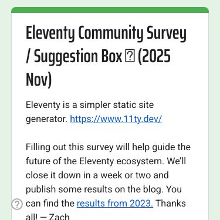

Please participate in the [**Eleventy Community Survey (and Suggestion Box) (2025)**](https://www.11ty.dev/survey/2025/)!

As we look to our current and future priorities, this survey offers folks from the community an opportunity to weigh in on what they’d like to see moving forward!

-   Looking for _even more_ ways to help? Head over to our [Enhancement Queue on GitHub](https://github.com/11ty/eleventy/discussions/categories/enhancement-queue) and upvote feature requests that you think are worthy!
-   Not had your fill of surveys yet? [11ty Bundle is also running one right now](https://docs.google.com/forms/d/e/1FAIpQLSfef-ekQaPHSRnIQY8iUn-fmR79P1BXep-j2jPM3RKCDEcDnw/viewform) as they work through a redesign!
-   **Related:** Our previous iteration of the survey: [_Eleventy Community Survey Results (2023)_](https://www.11ty.dev/blog/community-survey-results/)
