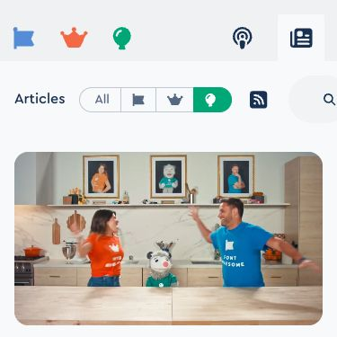

We’ve added a bit more [information about the new sponsorship tiers for the Build Awesome Kickstarter](https://blog.fontawesome.com/new-build-awesome-sponsorship-tiers/).

-   Your company uses Eleventy currently or wants to support the Build Awesome platform moving forward.
-   You’re interested in getting your [**brand icon in the Font Awesome Icon library**](https://fontawesome.com/icons/packs/brands) (for everyone to use!).
-   You want to plaster your **sponsor logo across the Awesomeverse** (Build Awesome, Font Awesome, and Web Awesome web sites).

If any of the above things apply to you, [have a look!](https://blog.fontawesome.com/new-build-awesome-sponsorship-tiers/)

Don’t see something that fits? [Contact me directly!](mailto:zach@awesome.me?subject=Build%20Awesome%20Sponsorship)

## Full Coverage

-   `2026 April` [**Build Awesome Pro Kickstarter**](https://www.kickstarter.com/projects/fontawesome/build-awesome-pro?ref=43ttgb)
-   `2026 May` [**Blog Awesome**: Introducing: Build Awesome](https://blog.fontawesome.com/introducing-build-awesome-static-site-platform-kickstarter/)
-   `2026 May` [**Blog Awesome**: New Sponsorship Tiers for the Build Awesome Kickstarter](https://blog.fontawesome.com/new-build-awesome-sponsorship-tiers/)
-   `2026 April` [Collaborative Editing as Progressive Enhancement](https://www.11ty.dev/blog/collaborative-editing/)
-   `2026 March` [Eleventy is now Build Awesome](https://www.11ty.dev/blog/build-awesome/)
-   `2026 March` [**Podcast Awesome**: Eleventy Is Rebranding to Build Awesome: What Changes (and What Doesn’t)](https://www.podcastawesome.com/2092855/episodes/18785266-eleventy-is-rebranding-to-build-awesome-what-changes-and-what-doesn-t) <code class="elv-tag"><svg class="fa11ty-icon" viewBox="0 0 448 512"><use href="#fas-fa-headphones" xlink:href="#fas-fa-headphones"></use></svg>24m</code>
-   `2026 March` [**Eleventy Meetup** (on YouTube): AMA about Build Awesome, an Open Town Hall](https://www.youtube.com/watch?v=lA-wD89m6jM) <code class="elv-tag"><svg class="fa11ty-icon" viewBox="0 0 576 512"><use href="#fas-fa-video" xlink:href="#fas-fa-video"></use></svg>44m</code>
