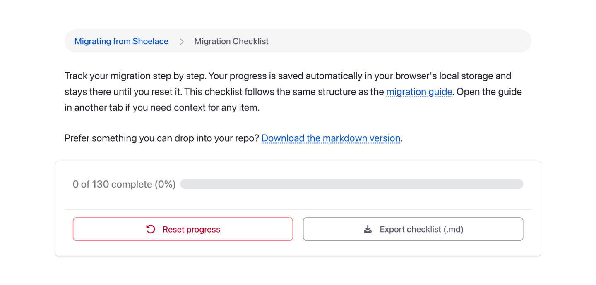

The latest release of Shoelace shipped on March 11, 2025. It’s still on npm, it’s still two lines away from any HTML page, and it still works as well today as it did the day it went out.

It’s also the last Shoelace release there’s ever going to be.

None of that is news. [We launched Web Awesome back in October](https://blog.fontawesome.com/web-awesome-component-library/), and the banner has been sitting on the Shoelace docs ever since. So I’m not here to tell you it happened. I’m here to answer the question everyone keeps asking:

_Why should I switch to Web Awesome?_

<video height="720" style="aspect-ratio: 1280 / 720;" width="1280" autoplay="" loop="" muted="" src="what-is-wa-sC1xfnCTCorp-Vp3J4pVcdA98.mp4" playsinline=""></video>

“Because it’s the successor” doesn’t cut it when you’ve got an app full of `sl-` tags and a manager asking why you want to spend a week on this.

So let’s put them side by side. Nothing breaks tomorrow if you stay put, but the case is better than most folks realize, and it’s a lot more than a rename.

## What Actually Changed

Shoelace was a component library. Web Awesome is a design system.

That sounds like something a marketing page says, so let me be specific. Shoelace gave you 58 components, a set of `--sl-*` tokens, and a light and dark theme. Everything else was your problem: layout, typography, spacing, the styling of your plain old `<table>` and `<h2>`.

<video height="720" style="aspect-ratio: 1152 / 720;" width="1152" autoplay="" loop="" muted="" src="wa-components-v7N0ahBwgoHW-uelDDdNpQ5rN.mp4" playsinline=""></video>

Web Awesome 3.11 gives you 70 free components _plus_ the rest of the page. Native element styles. Layout and typography utilities. Eleven themes. Nine color palettes. A theming API that goes deeper than swapping two stylesheets.

And it’s still free and open source under the MIT license. That part was never negotiable.

## What Folks (Probably) Care About the Most

There are components you couldn’t build with Shoelace without writing your own. `<wa-callout>` for inline messaging. <code><a href="https://webawesome.com/docs/components/popover/">&lt;wa-popover&gt;</a></code> for anchored content that isn’t a tooltip and isn’t a dropdown. <code><a href="https://webawesome.com/docs/components/scroller/">&lt;wa-scroller&gt;</a></code> for overflow containers with real scroll affordances. Then <code><a href="https://webawesome.com/docs/components/accordion/">&lt;wa-accordion&gt;</a></code>, <code><a href="https://webawesome.com/docs/components/page/">&lt;wa-page&gt;</a></code>, <code><a href="https://webawesome.com/docs/components/number-input/">&lt;wa-number-input&gt;</a></code>, <code><a href="https://webawesome.com/docs/components/time-input/">&lt;wa-time-input&gt;</a></code>, <code><a href="https://webawesome.com/docs/components/zoomable-frame/">&lt;wa-zoomable-frame&gt;</a></code>, <code><a href="https://webawesome.com/docs/components/intersection-observer/">&lt;wa-intersection-observer&gt;</a></code>, and more.

Your plain HTML gets styled, too. Web Awesome ships a `native.css` layer that styles real elements: headings, tables, form controls, `<figcaption>`, the works. If you were around for the [original Shoelace](https://www.abeautifulsite.net/posts/shoelacecss-a-back-to-the-basics-css-starter-kit/) in 2017, that might feel a little familiar. That project was a CSS starter kit before it was ever a component library. It took me about nine years, but the idea made it back in

You get CSS utilities, too. Layout primitives like `wa-stack`, `wa-cluster`, and `wa-split`. Gap, alignment, border radius, and text utilities. A `wa-prose` class for long-form content. Nothing resembling a build step.

Component styles live in `@layer wa-component`, which means your unlayered CSS wins by default. Go delete your `!important` declarations. I’ll wait.

Icons are Font Awesome by default instead of Bootstrap Icons, and if you have a Font Awesome Pro Kit, that works too.

There’s server-side rendering. As of 3.8, components render on the server via Declarative Shadow DOM and hydrate when your JavaScript arrives. Less layout shift, better first paint. It’s experimental, but it’s real and people are using it.

And there’s a theme called Shoelace. There’s a built-in `shoelace` theme and a matching `shoelace` color palette, so you can migrate the markup without explaining to your designer why every button looks different on Monday.

<video height="920" style="aspect-ratio: 1920 / 920;" width="1920" autoplay="" loop="" muted="" src="shoelace-theme-yiqONypzNLgt-B60uhCghieha.mp4" playsinline=""></video>

It installs the way it always has. Paste a stylesheet and a module script into your `<head>`, served from our own CDN, and start writing tags. Or `npm install @awesome.me/webawesome` and bundle it like anything else. No framework, no wrapper, no build step you weren’t already running.

## Side by Side

<table class="has-fixed-layout"><tbody><tr><td></td><td><strong>Shoelace 2</strong></td><td><strong>Web Awesome Core</strong></td><td><strong>Web Awesome Pro</strong></td></tr><tr><td><strong>Status</strong></td><td>Sunset, 2.20.1, March 2025</td><td>Active, 3.10.0, June 2026</td><td>Active</td></tr><tr><td><strong>License</strong></td><td>MIT</td><td>MIT</td><td>Commercial, alongside the MIT core</td></tr><tr><td><strong>Components</strong></td><td>58</td><td>66</td><td>Everything free, plus the list below</td></tr><tr><td><strong>Icons</strong></td><td>Bootstrap Icons</td><td>Font Awesome Free</td><td>Font Awesome Pro via Kit</td></tr><tr><td><strong>Themes</strong></td><td>Light + dark</td><td>Default, Awesome, Shoelace</td><td>8 more (Active, Brutalist, Glossy, Matter, Mellow, Playful, Premium, Tailspin)</td></tr><tr><td><strong>Color palettes</strong></td><td>1</td><td>3</td><td>9</td></tr><tr><td><strong>Native element styles</strong></td><td>–</td><td>✅</td><td>✅</td></tr><tr><td><strong>CSS utilities</strong></td><td>–</td><td>✅</td><td>✅</td></tr><tr><td><strong>Cascade layers</strong></td><td>–</td><td>✅</td><td>✅</td></tr><tr><td><strong>Server-side rendering</strong></td><td>–</td><td>✅</td><td>✅</td></tr><tr><td><strong>Theme Builder</strong></td><td>–</td><td>–</td><td>✅</td></tr><tr><td><strong>Pattern library</strong></td><td>–</td><td>–</td><td>✅</td></tr><tr><td><strong>Hosted projects + CDN</strong></td><td>–</td><td>–</td><td>✅</td></tr><tr><td><strong>Figma design kit</strong></td><td>–</td><td>–</td><td>✅</td></tr><tr><td><strong>Support</strong></td><td>Community</td><td>Community + us</td><td>Priority support</td></tr><tr><td><strong>Price</strong></td><td>Free</td><td>Free</td><td><a href="https://webawesome.com/purchase" target="_blank" rel="noopener">Commercial license</a></td></tr></tbody></table>

Pro components, for the record: <code><a href="https://webawesome.com/docs/components/combobox/">&lt;wa-combobox&gt;</a></code>, <code><a href="https://webawesome.com/docs/components/file-input/">&lt;wa-file-input&gt;</a></code>, <code><a href="https://webawesome.com/docs/components/date-picker/">&lt;wa-date-picker&gt;</a></code>, [`<wa-date-input>`,](https://webawesome.com/docs/components/date-input/) <code><a href="https://webawesome.com/docs/components/video/">&lt;wa-video&gt;</a></code>, <code><a href="https://webawesome.com/docs/components/video-playlist/">&lt;wa-video-playlist&gt;</a></code>, <code><a href="https://webawesome.com/docs/components/sparkline/">&lt;wa-sparkline&gt;</a></code>, and the Chart.js-backed chart family (bar, line, pie, doughnut, bubble, radar, scatter, and polar area). A data grid is on the way.

## A Word About Pro

I’d rather you hear this from me than figure it out halfway through a migration.

Web Awesome Pro exists so Web Awesome Core can keep existing. Every subscription pays for the bug fixes and the new components that everyone gets, free users included. Pro just moves you to the front of the line when you need a hand. Over 7,000 people backed the Kickstarter to make that model work, and I’m still a bit stunned by it.

Almost none of your migration touches Pro. The components you built your Shoelace app with are in Core, and that’s where they’re staying. The one place Pro comes up is if you had a second library bolted onto Shoelace for charts, comboboxes, or the like. Those live in Pro now, and moving to a first-party version is optional, not required.

## How Hard Is This, Really?

Less hard than you’re expecting.

Most components migrate on a `sl-` to `wa-` rename and nothing else, which covers roughly two thirds of the library. Tokens go from `--sl-*` to `--wa-*`. `variant="primary"` becomes `variant="brand"`. The `outline` and `filled` booleans became `appearance="outlined"`and `appearance="filled"`. Slots named `prefix` and `suffix` are now `start` and `end`. `help-text` is now `hint`.

A handful of things changed shape rather than name. `<sl-menu>` became `<wa-dropdown>`, `<sl-range>` became `<wa-slider>`, `<sl-image-comparer>` became `<wa-comparison>`, and `<sl-visually-hidden>` is now a `wa-visually-hidden` utility class you can put on anything.

The parts that bite quietly are event listener strings, `::part()` selectors, and icon names. None of those throw an error. They just stop doing what you expected. Color scales also inverted, so `--sl-color-primary-600` doesn’t map to the number you’d guess.

All of it is written down in the [migration guide](https://webawesome.com/docs/resources/migrating-from-shoelace/), along with a [checklist](https://webawesome.com/docs/resources/migration-checklist) you can work through file by file. The guide also includes a prompt you can hand to a coding agent, and it’ll do most of the mechanical work for you. I was skeptical about including that. Then I watched it migrate a real project in an afternoon.

## Should You Migrate?

If your Shoelace app is stable and shipped and you’re not touching it, no, you don’t need to do anything this week. It’ll keep working.

But there won’t be another Shoelace release. No new components, no fixes, no answers on the issue tracker. Every hour of work is going into Web Awesome now. If you’re actively building on Shoelace, every new feature you ship is more code you’ll eventually have to migrate. The sooner you switch, the less of it there is.

<video height="720" style="aspect-ratio: 1280 / 720;" width="1280" autoplay="" loop="" muted="" src="you-want-more-caption-aRNTM362-weBMTqUND4gL.mp4" playsinline=""></video>

Start with the [migration guide](https://webawesome.com/docs/resources/migrating-from-shoelace/). Pick one page. Rename one prefix. It’s usually much easier than it sounds.

## Thank You

More than a year after the last release, Shoelace is still serving [over two million requests a month](https://www.jsdelivr.com/package/npm/@shoelace-style/shoelace) on jsDelivr alone. That’s all of you, still building things. Every issue, every PR, every “hey, this is broken” in Discord got the project further than I could have taken it alone, and Web Awesome is that same project with more people and more hours behind it.

Come see what we’ve built. And keep building awesome stuff!
