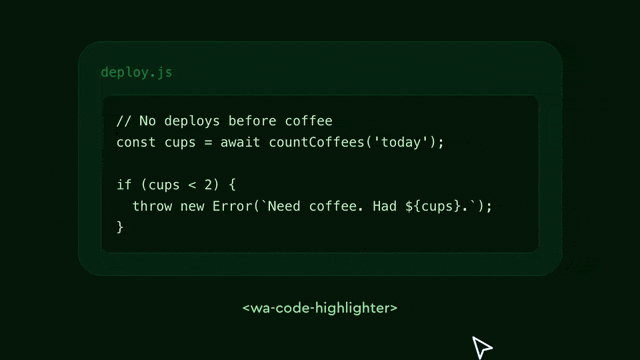
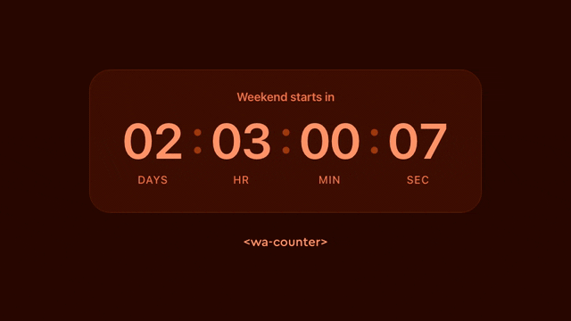
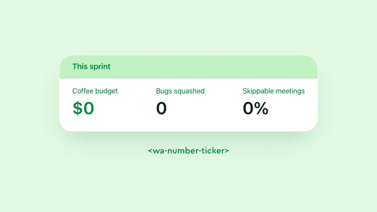
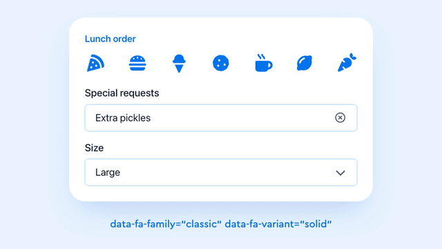
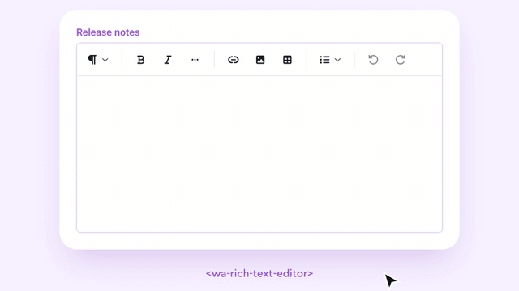

_Show it off, count it up, write it down._ _Web Awesome 3.15 brings five new components, an easier way to style every icon on the page, and two Pro favorites leaving experimental._

**🖼️ Lights, Camera, Lightbox**

Got a gallery that deserves more than a grid of thumbnails? Wrap it in `<wa-lightbox>` and your photos and videos open full screen with one click. Visitors can swipe from one to the next, click to zoom in on the details, and jump straight to the one they want with a thumbnail strip.

Product shots, portfolios, event photos, that video of your cat knocking things off the counter. They all get the big-screen treatment.

**🌈 Code Samples That Bring the Color**

Set a `language` on `<wa-code-highlighter>` and your code sample gets syntax colors plus a copy button, no extra setup. It knows 40 languages out of the box, and if yours isn’t on the list, you can add your own.

Here’s the nerdy part we’re proud of. It highlights with the browser’s CSS Custom Highlight API, so it never wraps your code in a pile of extra ``s. Your markup stays exactly the way you wrote it.

**🔢 Two Components You Can Count On**

`<wa-counter>` counts down to a date or up from one. Product launches, flash sales, conference kickoffs, the number of days since someone last said “it works on my machine.” Point it at a date and it does the rest.

`<wa-number-ticker>` counts up to a number when it scrolls into view. Ideal for stats on a landing page, dashboard totals, or showing off how many cups of coffee went into your last release.

**🍕 One Attribute to Style Them All**

Want every icon on your page in Duotone? Or Sharp? Add `data-fa-family` and `data-fa-variant` to your page and every `<wa-icon>` switches style in one move. No find-and-replace across a hundred templates.

In Pro, it goes further: the icons inside Web Awesome components (the chevrons, checkmarks, and close buttons) switch along with the rest.

**✍️ A Rich Text Editor (Literally)**

New in Pro, `<wa-rich-text-editor>` gives your users a proper writing space with a toolbar, keyboard shortcuts, and Markdown-style typing. Type `##` for a heading or `-` for a list and it just happens.

Best of all, it submits with your form like a regular `<textarea>`. Drop it into a comment form, a CMS, or a support ticket and you’re done.

Don’t have Pro? [Get Web Awesome Pro](https://webawesome.com/pro) and start writing.

**☝️ A Quick Note on “Experimental”**

All five new components are experimental for now. We want to see them battle-tested on real websites before we call them stable. Kick the tires, build something, and if something isn’t working for you, [let us know](https://github.com/shoelace-style/webawesome/issues).

**🎓 Graduation Day for Stepper and Data Grid**

Speaking of battle-tested: `<wa-stepper>` and `<wa-data-grid>` (Pro) are now stable. If you’ve been waiting for the “experimental” label to come off before using them in production, consider this your green light.

**🧰 Plus 50+ Fixes**

This release also packs in more than 50 fixes, including ten for `<wa-dropdown>` alone. The changelog has the full list.

**📬 Never Miss a Release**

Web Awesome keeps going at [webawesome.com](https://webawesome.com/). If you’d like to get notified when new releases drop, you can signup on [the changelog page](https://webawesome.com/docs/resources/changelog). And make sure to get into the [Discord](https://discord.gg/mg8f26C) if you’re not already there.

You can also find us online at:

-   [Bluesky](https://bsky.app/profile/webawesome.com)
-   [Mastodon](https://mastodon.social/@webawesome)
-   [X](https://x.com/webawesomer)

Thanks for truly putting the _Awesome_ in Web Awesome.
