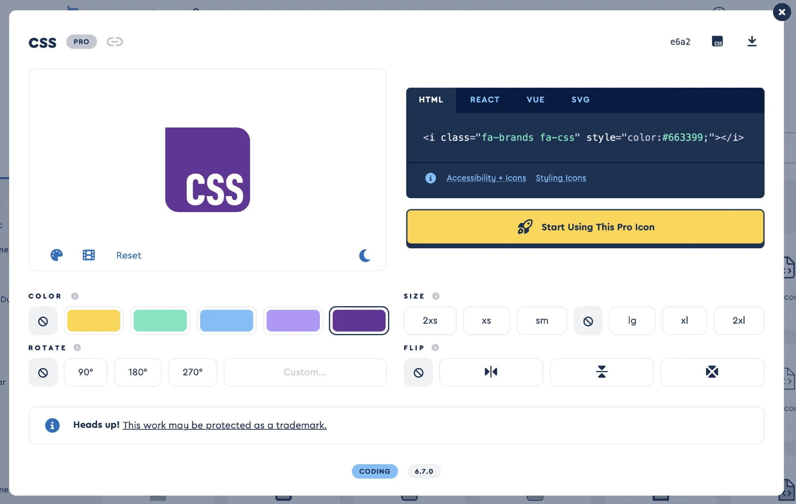
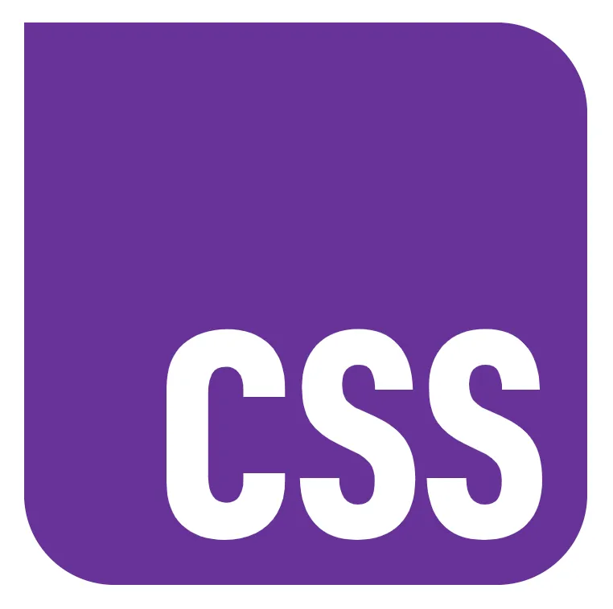

🤫 Spoiler alert! Thanks to [@jabron.us](https://bsky.app/profile/did:plc:633y2eiibd2rdqfqxt5qpmqw) ’s superhuman icon design efficiency, we were able to slot the new CSS logo into the imminent 6.7 release!

[fontawesome.com/icons/css?f=...](https://fontawesome.com/icons/css?f=brands&s=solid&pc=%23663399&sc=%23663399)

However, we moved fast and broke things 🥲: we accidentally made it Pro-only, but it will be included in FA Free in 6.7.1.

> New CSS logo just dropped. Thanks for the tip, [@jabron.us](https://bsky.app/profile/did:plc:633y2eiibd2rdqfqxt5qpmqw)!
> 
> More info: [github.com/CSS-Next/log...](https://github.com/CSS-Next/logo.css)
> 
> 
> 
> — [Cory LaViska](https://bsky.app/profile/cory.laviska.com) ([November 15, 2024 at 6:26:56 PM UTC](https://bsky.app/profile/cory.laviska.com/post/3layyv5zuz224))
