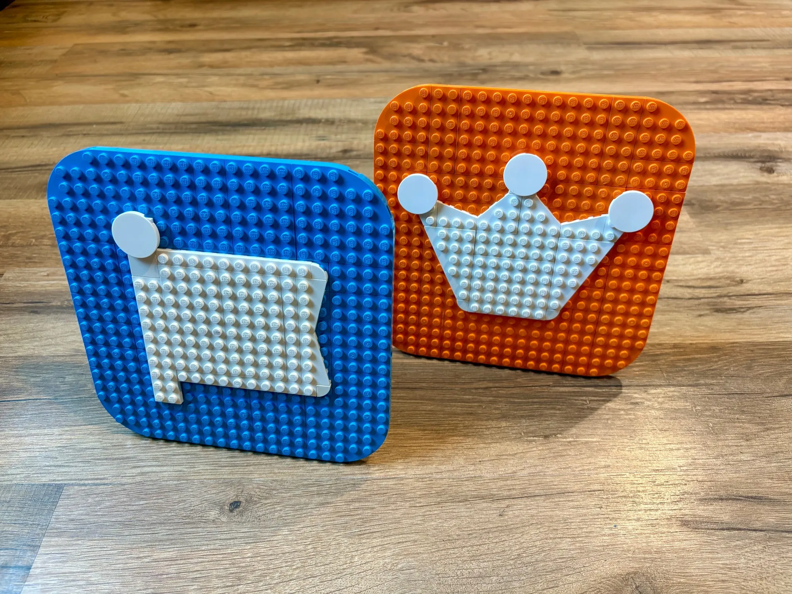

Let's go LEGO our logo!

> If you've ever wondered if you could make the [@fontawesome.com](https://bsky.app/profile/did:plc:spcmfh6ub7op2y2rrondrfwg) and [@webawesome.com](https://bsky.app/profile/did:plc:uocu7waljw6y5e474k26n7ve) logos out of LEGO... well, yes. Yes, you can.
> 
> 
> 
> — [Jory Raphael](https://bsky.app/profile/shkspr.bsky.social) ([July 18, 2025 at 6:26:27 PM UTC](https://bsky.app/profile/shkspr.bsky.social/post/3lub33ujle22f))
