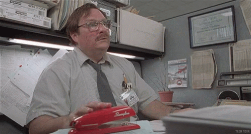

On this episode of Podcast Awesome, we dive deep into Office Space lore and tell the story behind the red stapler icon.  
🎥 Watch here → [youtu.be/FEKq7yz8sk8?...](https://youtu.be/FEKq7yz8sk8?si=iynWjIiTfckUWvPI)  
🎧 Listen here → [www.buzzsprout.com/2092855/epis...](https://www.buzzsprout.com/2092855/episodes/17590970)

