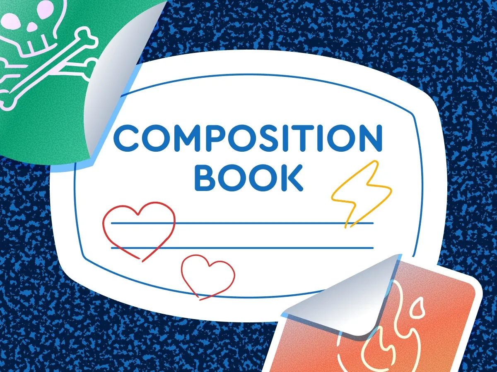
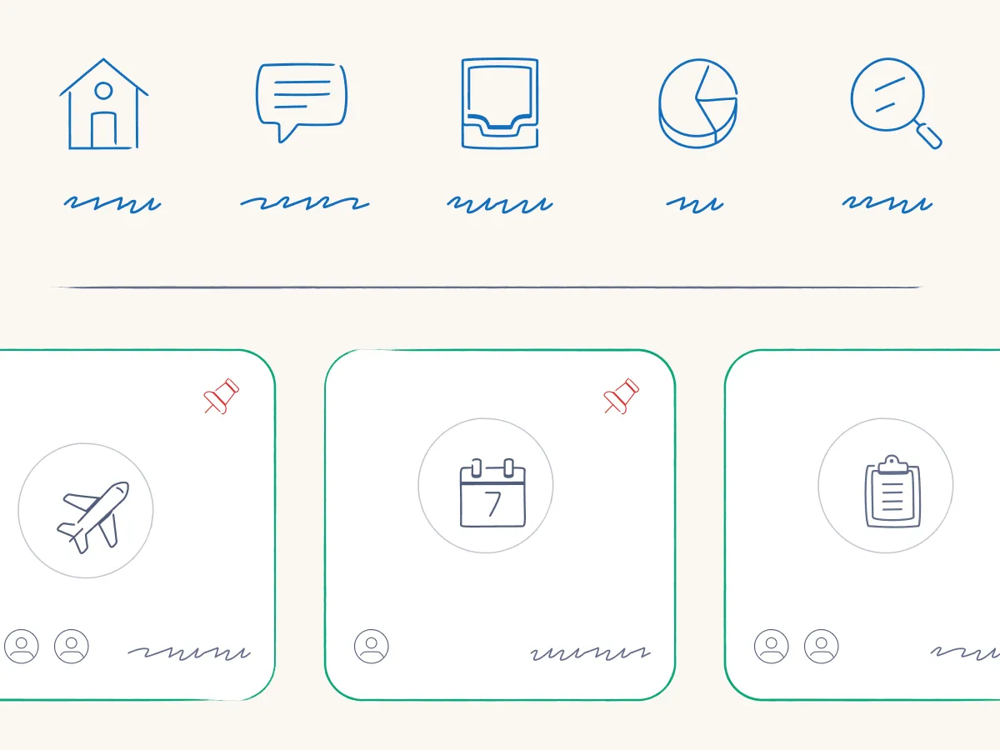
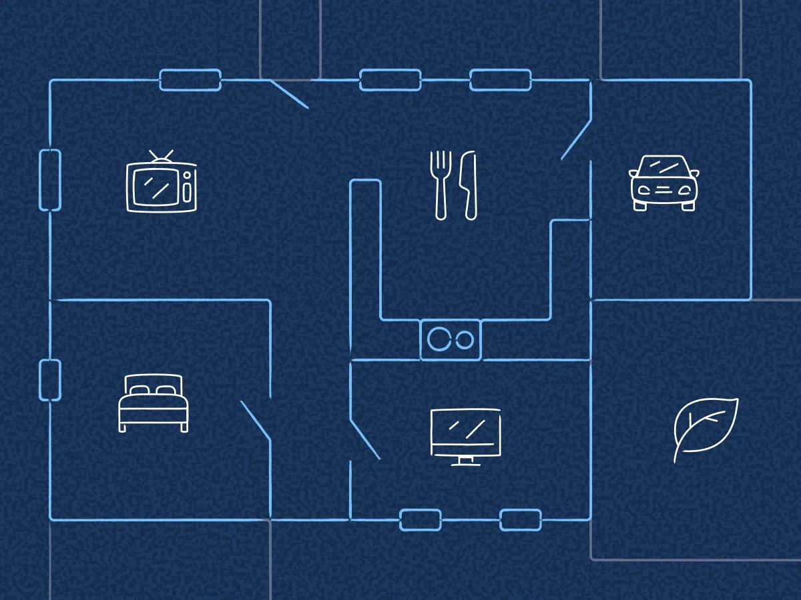
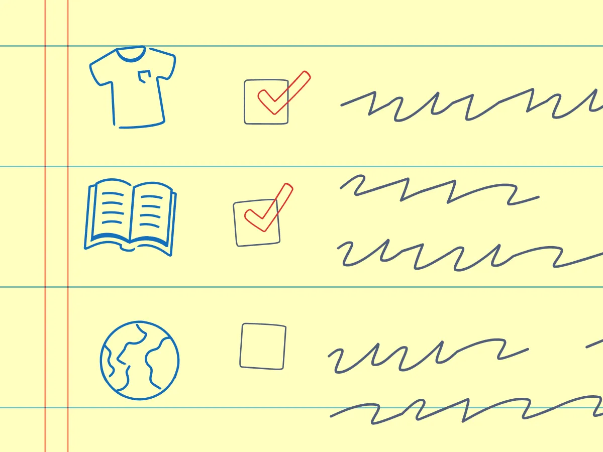

Graphite is a hit for anyone building “notes / learning / planning” UIs. ✏️📓  
Hand-drawn icons change the tone of an interface instantly without rewriting a single word. What kind of site will you be adding these to?  
[fontawesome.com/icons/packs/...](https://fontawesome.com/icons/packs/graphite)

   
