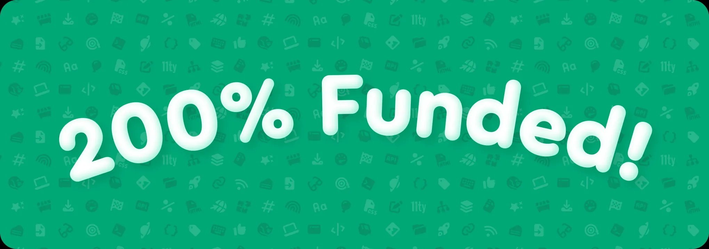

200% funded. Folks… wow. 😱 We’re blown away by the support.

Join us live tomorrow for Dave’s color theming demo + AMA on Build Awesome!

📅 May 5 at 11am ET / 10am CT / 8am PT → [www.youtube.com/live/XBMSvup...](https://www.youtube.com/live/XBMSvupE7Bc?si=T3l2Anm6X8aCCJvx)

🔗 Kickstarter → [www.kickstarter.com/projects/fon...](https://www.kickstarter.com/projects/fontawesome/build-awesome-pro?ref=d0s9n9)

