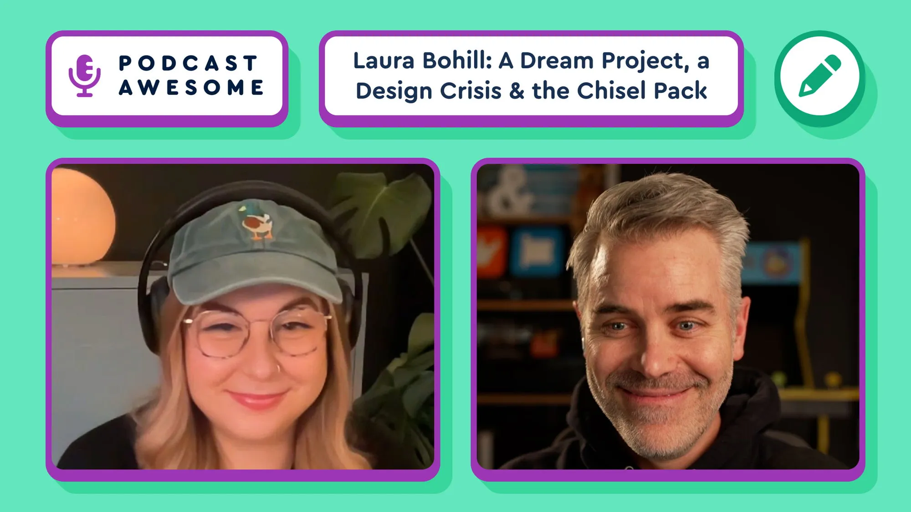

Laura Bohill got a brief for Font Awesome 7: make something expressive, no rules, total freedom.

Reader, she had an existential crisis.

The result is Chisel — and it's unlike anything we've released. New Podcast Awesome episode is live. 🎙️

Watch → [youtu.be/ALlNUTYC83g?si=Yi-xA...](https://youtu.be/ALlNUTYC83g?si=Yi-xANnkrfqaiCed)

