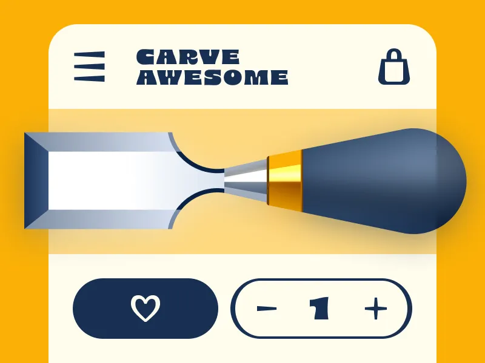

The whole concept came from a book cover. Specifically the stroke contrast in the typeface on it.

Laura had one question: can you bring thick-to-thin stroke contrast into an icon system?

Nobody had really done it. She wasn't sure it would work. She did it anyway.

Watch → [youtu.be/ALlNUTYC83g?...](https://youtu.be/ALlNUTYC83g?si=O8fA_ViTGAPYiHsA)

   
