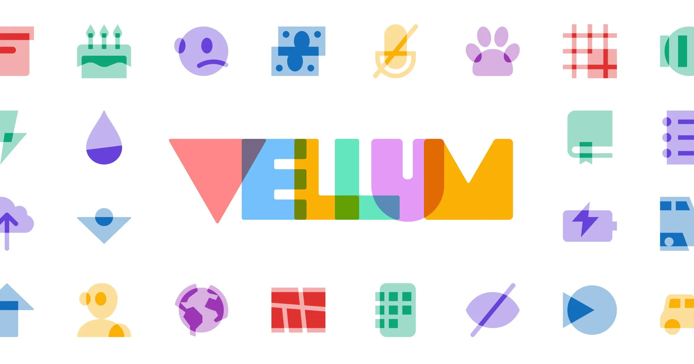

FA Vellum: guest designer Brian Brasher created a small-batch set of icons that are layered, overlapping slabs of visual significance. Like a good joke: it's all about those layers. Available with Font Awesome Pro+ only. [fontawesome.com/icons/packs/v...](https://fontawesome.com/icons/packs/vellum)

