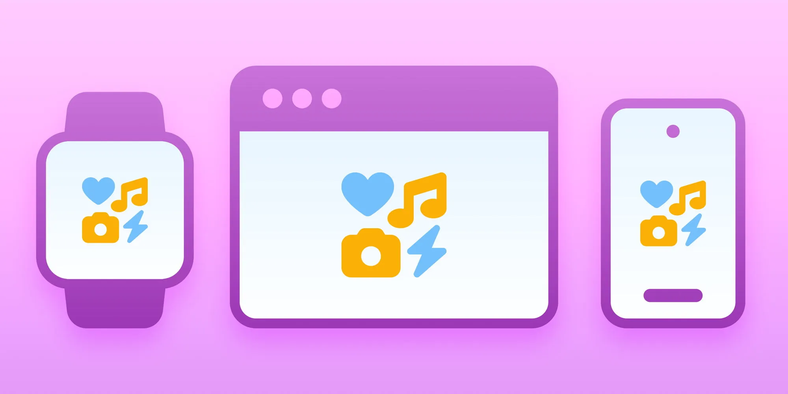

Why do some interfaces just feel right?

Spoiler: it's not just colors and components. It's visual cohesion.

We pixel-peep the details in our latest Blog Awesome. 👀  
[blog.fontawesome.com/visual-c...](https://blog.fontawesome.com/visual-cohesion-design-systems/)

