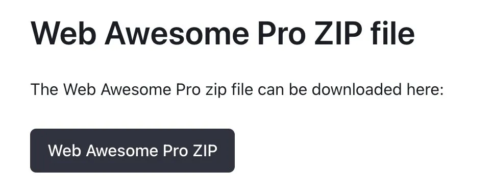

We snuck a surprise into this release for pro users. Head over to the Installation page to grab it. (Make sure you're logged in!)

> 🚀 Web Awesome 3.0.0-beta.3 has been released!
> 
> This was primarily a bug fix release. View the changelog here: [webawesome.com/docs/resourc...](https://webawesome.com/docs/resources/changelog)
> 
> — [Web Awesome](https://bsky.app/profile/webawesome.com) ([July 21, 2025 at 3:35:07 PM UTC](https://bsky.app/profile/webawesome.com/post/3luicwax2jc2w))
