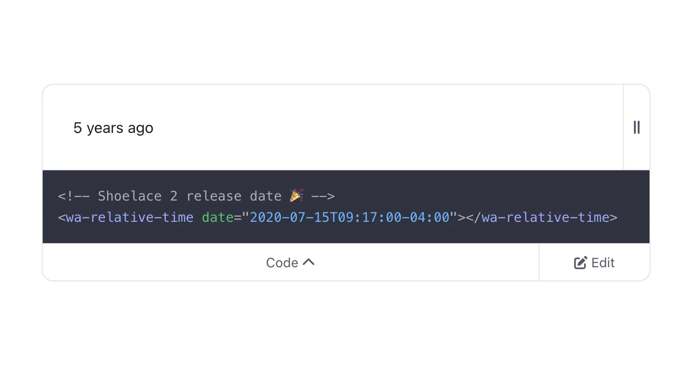

Format relative times like a champ with our declarative wrapper around the platform's Intl.RelativeTimeFormat API.

[webawesome.com/docs/compone...](https://webawesome.com/docs/components/relative-time/)

