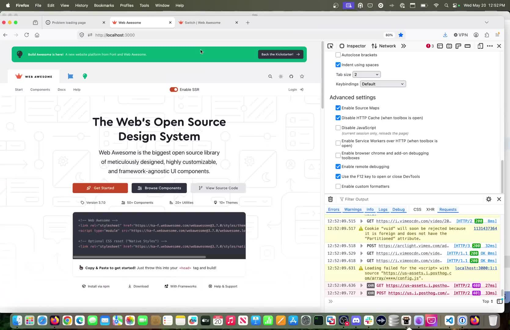

👀

> Since Web Awesome SSR is still fairly experimental, I decided to add a toggle for SSR to see what a a page may look like (not deployed yet, still fixing some ssr issues) but figured i'd share a preview.
> 
> 
> 
> — [Konnor Rogers](https://bsky.app/profile/konnorrogers.com) ([May 20, 2026 at 4:57:21 PM UTC](https://bsky.app/profile/konnorrogers.com/post/3mmcesar6os2f))
