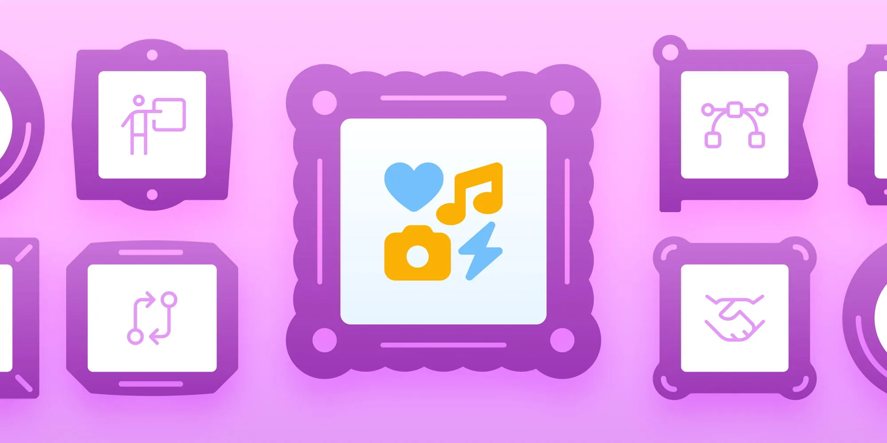

Icons look like the small stuff in a design system. They're not. They communicate faster than words and become some of the most recognizable parts of your brand. (We might be a little biased.) Part IV, live now: [blog.fontawesome.com/art-of-i...](https://blog.fontawesome.com/art-of-iconography-future-proof-design-system-part-4/)

