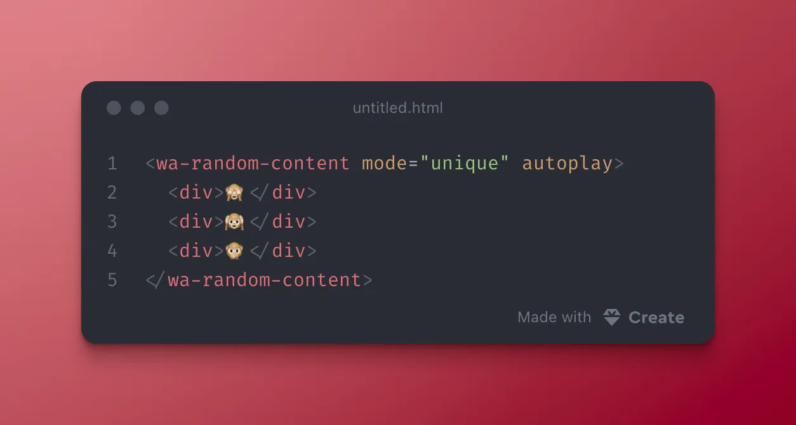

More about random content over at [blog.fontawesome.com/web-awesome-...](https://blog.fontawesome.com/web-awesome-random-content/)

> \<wa-random-content> is stable as of 3.13!
> 
> Slot tips, call randomize(), or turn on autoplay. Set mode="unique" so you don’t get the same tip twice in a row. Works on static pages, too!
> 
> 
> 
> — [Web Awesome](https://bsky.app/profile/webawesome.com) ([September 30, 2026 at 2:43:17 PM UTC](https://bsky.app/profile/webawesome.com/post/3mwqlcy4c5c27))
