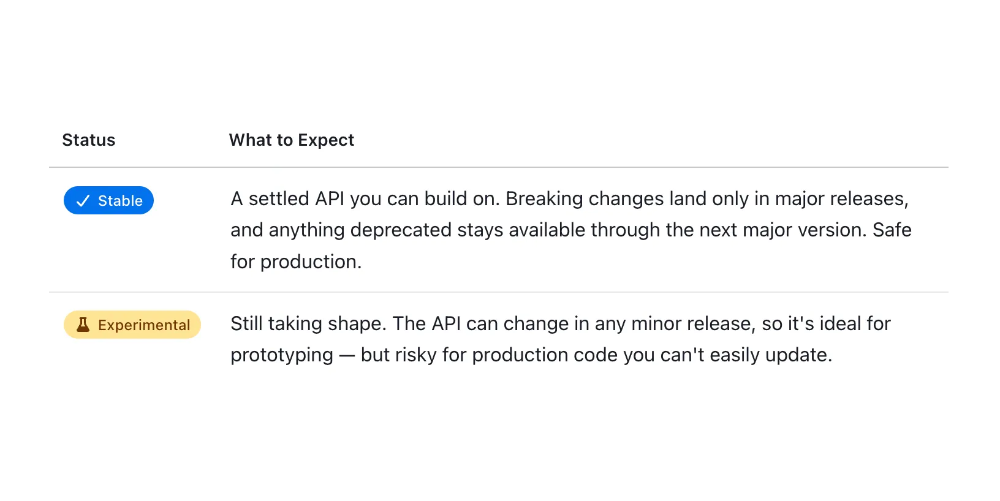

The experimental badge isn't marketing fog, it means we need testers and feedback and things \_could\_ change between now and the final version. (Rarely happens unless we find a critical issue)

Stable = battle-tested, ready to build.

We label both so you don't have to guess.

