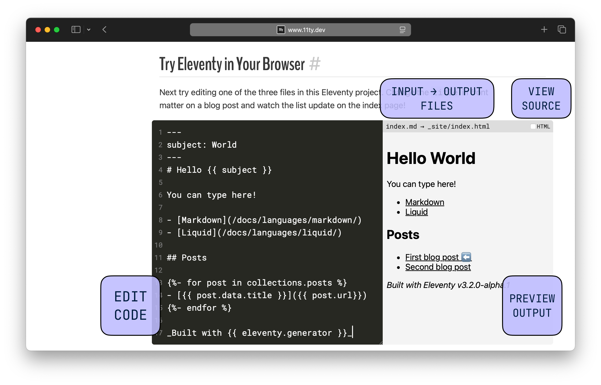

Try out the new interactive Playground component on the docs home page: [https://www.11ty.dev/#try-eleventy-in-your\-browser](https://www.11ty.dev/#try-eleventy-in-your-browser)

That’s right: we’re running Eleventy in the build and in the browser. This unlocks many more exciting options for Eleventy projects — stay tuned!

