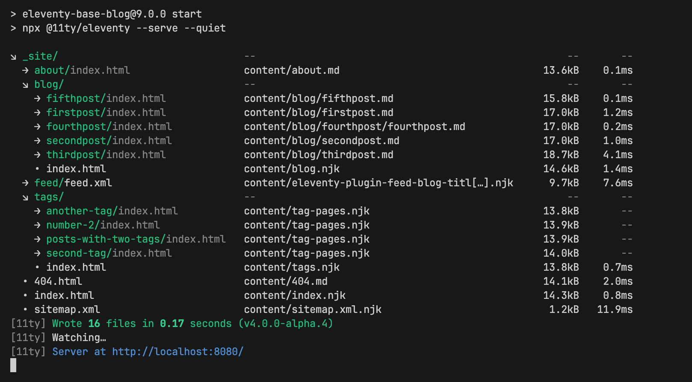

Did you know? 💡 Eleventy has an official plugin that shows your project’s output files organized by directory with file sizes and compile/render times shown? Compatible with Eleventy v1 and newer!

[https://www.11ty.dev/docs/plugins/directory-output/](https://www.11ty.dev/docs/plugins/directory-output/)

