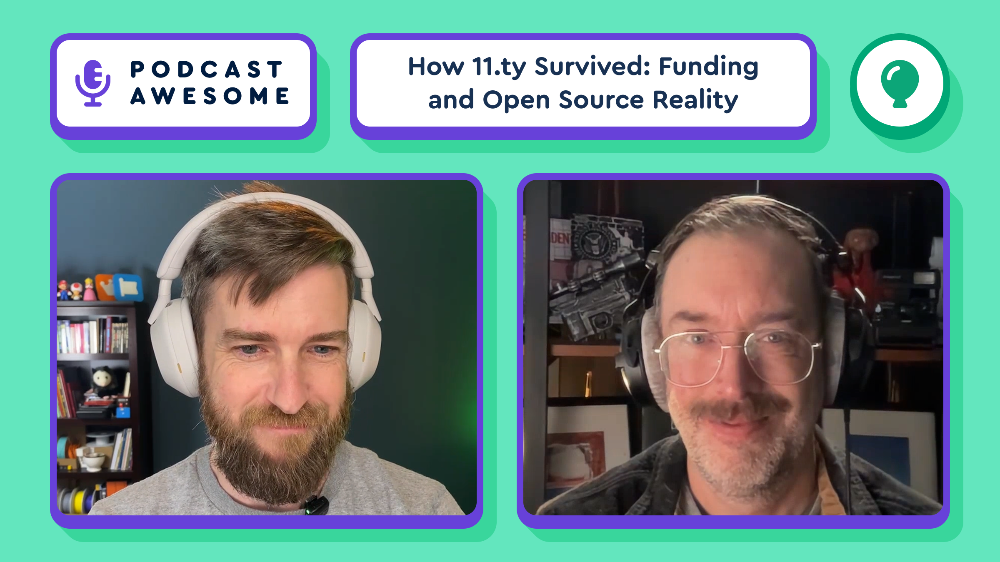

We’ve seen what happens when open source isn’t tied to the bottom line.  
Good intentions. Big promises. Sudden endings.  
A sustainable model changes everything.  
The best open source projects are built to stick around.

Watch → [https://youtu.be/GrLHE5djtPA?si=jN3LgBO-l0hXbcoc](https://youtu.be/GrLHE5djtPA?si=jN3LgBO-l0hXbcoc)  
Listen → [https://www.buzzsprout.com/2092855/episodes/18615318](https://www.buzzsprout.com/2092855/episodes/18615318)

