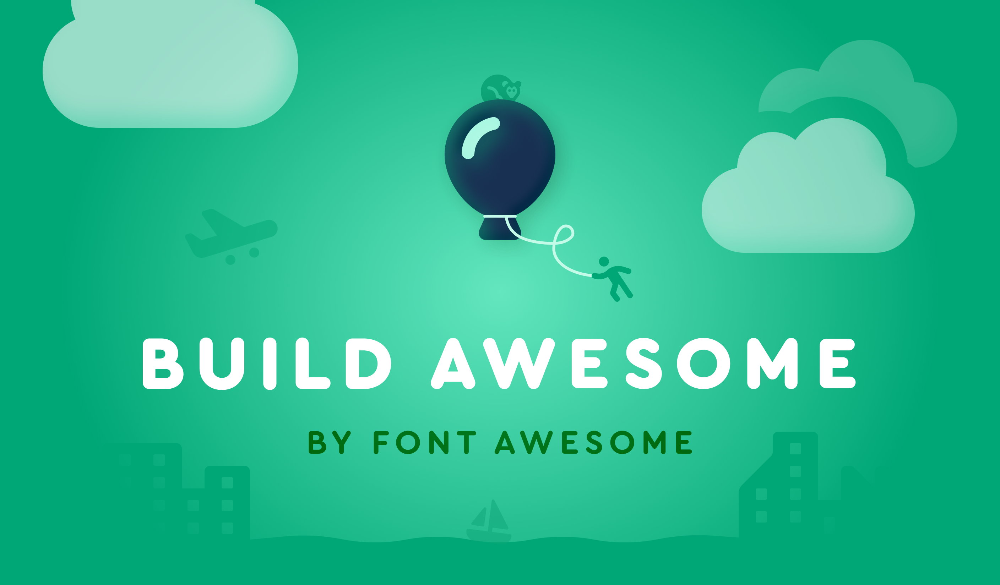

Did you hear? Eleventy is becoming Build Awesome!  
And yes. We're featuring a Kickstarter video with the Awesome-verse cast you know and love.

→ Same open-source core.  
→ Optional Pro tools.  
→ Much bigger future.

Back the Kickstarter!  
[https://www.kickstarter.com/projects/fontawesome/build-awesome?ref=b4hezh](https://www.kickstarter.com/projects/fontawesome/build-awesome?ref=b4hezh)

