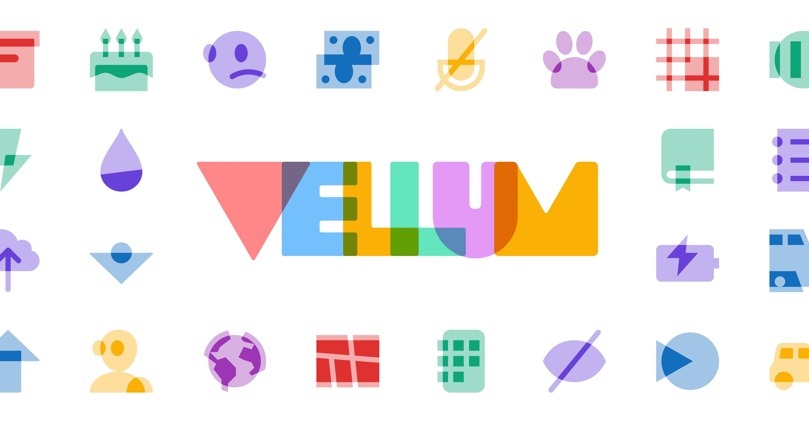

FA Vellum: layered icons from guest designer Brian Brasher that feature depth, dimension, and overlapping forms. Available now in Font Awesome Pro+. [https://fontawesome.com/icons/packs/vellum](https://fontawesome.com/icons/packs/vellum)

