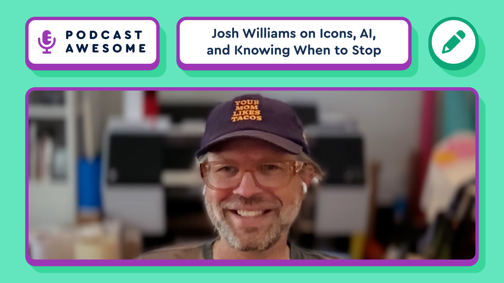

Part 2 with Josh Williams: software's "final season," why Gowalla and Path are worth studying, and what AI actually changes about design taste and discernment. [#design](https://mastodon.social/tags/design) [#icons](https://mastodon.social/tags/icons) [#podcast](https://mastodon.social/tags/podcast)

Watch on YouTube -> [https://youtu.be/8VGw\_MduwX4](https://youtu.be/8VGw_MduwX4)  
Listen to the Pod -> [https://www.podcastawesome.com/episodes/episodes/19487560-josh-williams-on-icon-design-ai-and-knowing-when-to-stop-pt-2](https://www.podcastawesome.com/episodes/episodes/19487560-josh-williams-on-icon-design-ai-and-knowing-when-to-stop-pt-2)

