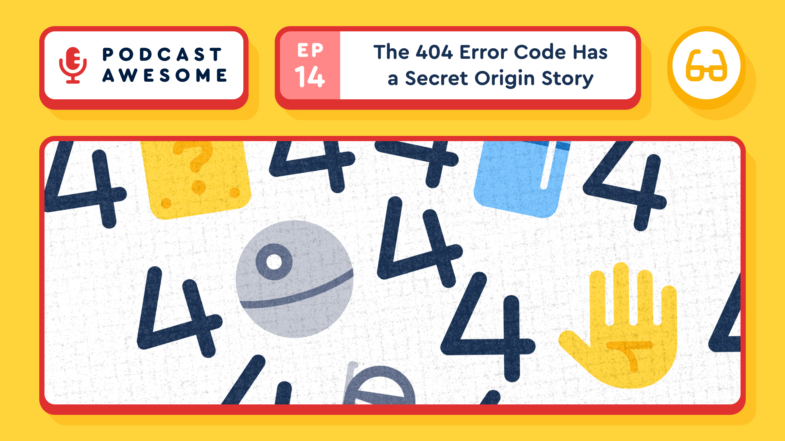

New pod: the "Room 404 at CERN" myth is completely made up, the real origin is delightfully boring, and somehow that all leads to 418 coffee pot protocol from 1998. What in the world are we even talking about?! Listen to the latest episode to find out! 🎙️

Watch → [https://youtu.be/S1ftZ\_Swnmg?si=UHPc3pgg242kXJG1](https://youtu.be/S1ftZ_Swnmg?si=UHPc3pgg242kXJG1)  
Listen → [https://www.podcastawesome.com/2092855/episodes/19564896](https://www.podcastawesome.com/2092855/episodes/19564896)

