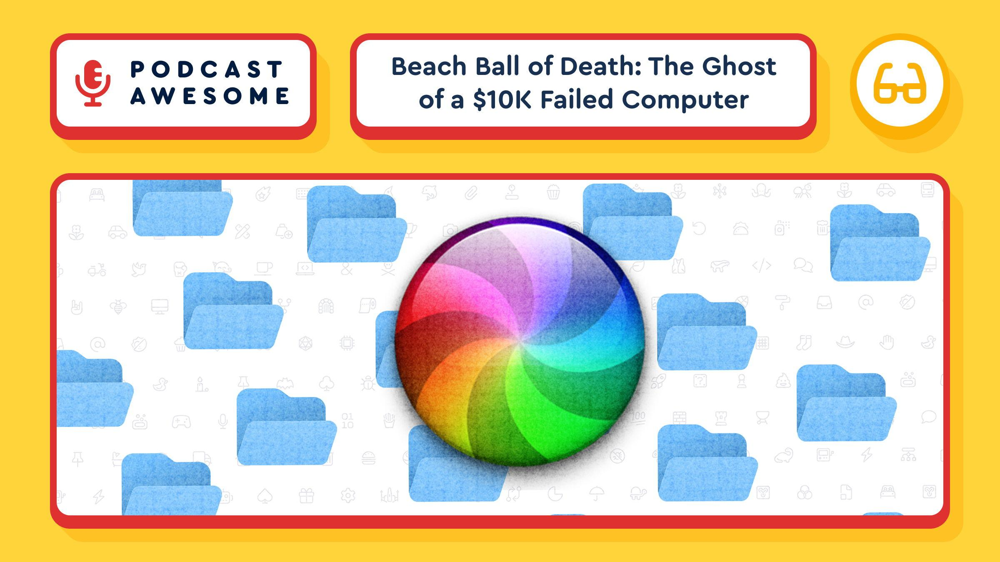

New episode of Podcast Awesome digs into the actual history of the Mac's "beach ball of death" cursor: Xerox PARC, Susan Kare, a failed $10,000 NeXT computer, and Steve Jobs's years outside of Apple.

Watch → [https://youtu.be/MothoHNhc7E?si=6GAlUXvu5eT06NfE](https://youtu.be/MothoHNhc7E?si=6GAlUXvu5eT06NfE)  
Listen → [https://www.buzzsprout.com/2092855/episodes/19626534](https://www.buzzsprout.com/2092855/episodes/19626534)

[#Apple](https://mastodon.social/tags/Apple) [#DesignHistory](https://mastodon.social/tags/DesignHistory) [#TechHistory](https://mastodon.social/tags/TechHistory) [#MacOS](https://mastodon.social/tags/MacOS) [#PodcastAwesome](https://mastodon.social/tags/PodcastAwesome)

