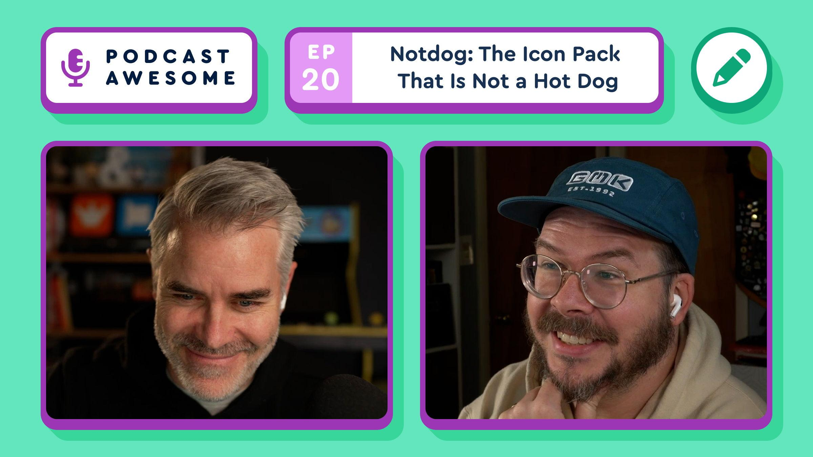

Notdog started out tubular, like the Frankfurter typeface it's based on. But icons need filled shapes, not just strokes, so the forms got blobbier & viscous. At that point, the icons looked less like hot dogs and more like condiments squeezed onto a plate.

Watch → [https://youtu.be/M4vPIkwaHro?si=e3KYR5bND0\_no1zT](https://youtu.be/M4vPIkwaHro?si=e3KYR5bND0_no1zT)

