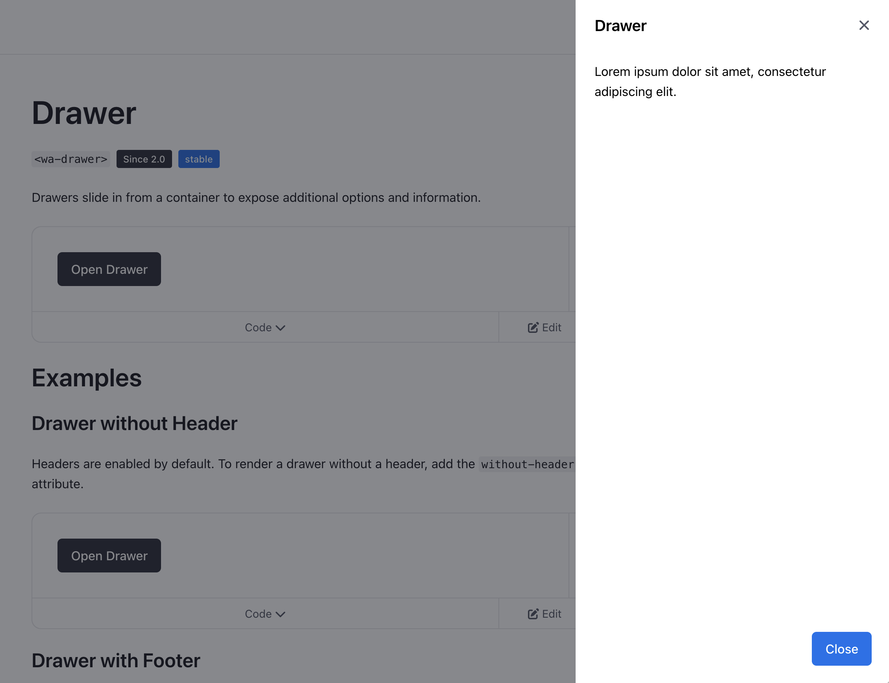

Web Awesome makes drawers easy. And with declarative invokers, you can open and close them without writing any JavaScript.

Docs: [https://webawesome.com/docs/components/drawer/](https://webawesome.com/docs/components/drawer/)

