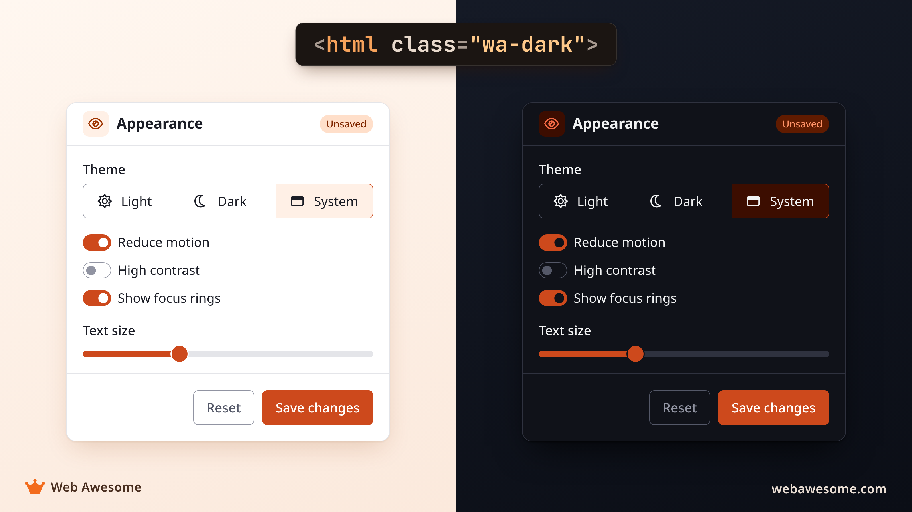

Somewhere out there, a team is on sprint three of their dark mode epic. Whether you're using Web Awesome components or just Native Styles, we already have dark mode covered with a class:

\<html class="wa-dark">

Works on a single section too.

